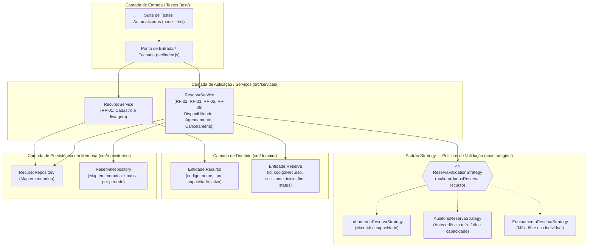

# Arquitetura — UniReserva

## Diagrama de Componentes e Camadas

## Relação com os ADRs

- **[`ADR-001-arquitetura-nodejs.md`](./adr/ADR-001-arquitetura-nodejs.md):** Define a adoção do Node.js 22 (ESM) sem dependências pesadas de runtime e a divisão nas 4 camadas representadas no diagrama acima (`services`, `strategies`, `domain` e `repositories`). Os serviços nunca acessam estruturas de dados cruas fora dos repositórios, e os repositórios isolam o armazenamento em memória (`Map`).
- **[`ADR-002-padrao-strategy-validacao-reservas.md`](./adr/ADR-002-padrao-strategy-validacao-reservas.md):** Define o bloco **Padrão Strategy** do diagrama. Quando `ReservaService` recebe um pedido de agendamento (`RF-03` e `RF-04`), ele primeiro verifica se o recurso existe/está ativo e se há conflito de horário no `ReservaRepository`; em seguida, seleciona a estratégia correspondente ao `recurso.tipo` (`LaboratorioReservaStrategy`, `AuditorioReservaStrategy` ou `EquipamentoReservaStrategy`) através do contrato comum `validar(dadosReserva, recurso)`.

## O que este diagrama não mostra

- **Detalhes de interface gráfica (UI/Frontend) ou rotas HTTP:** O foco arquitetural do projeto está na qualidade da camada de domínio, serviços, aplicação do padrão *Strategy* e verificação automatizada via testes.
- **Fluxo de Integração Contínua (CI):** A execução automática do ESLint e do `node --test` a cada Push/Pull Request está documentada no workflow [`.github/workflows/ci.yml`](../.github/workflows/ci.yml) e em [`docs/plano-de-teste.md`](./plano-de-teste.md).
- **Persistência em Banco de Dados Relacional:** Conforme justificado no `ADR-001`, a persistência utiliza coleções em memória para garantir determinismo, rapidez (< 50 ms para 1.000 registros conforme `RNF-01`) e independência de serviços externos durante o CI.
